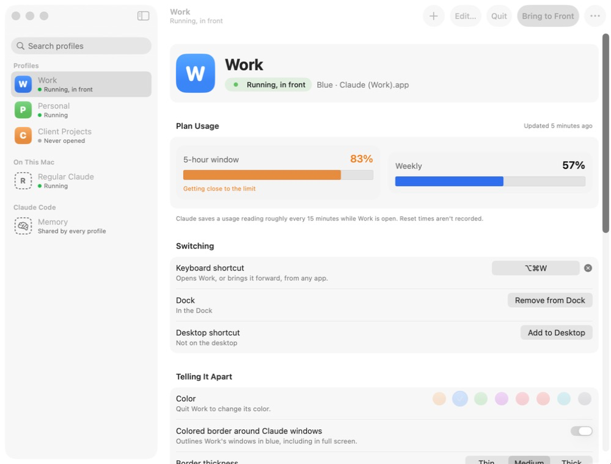
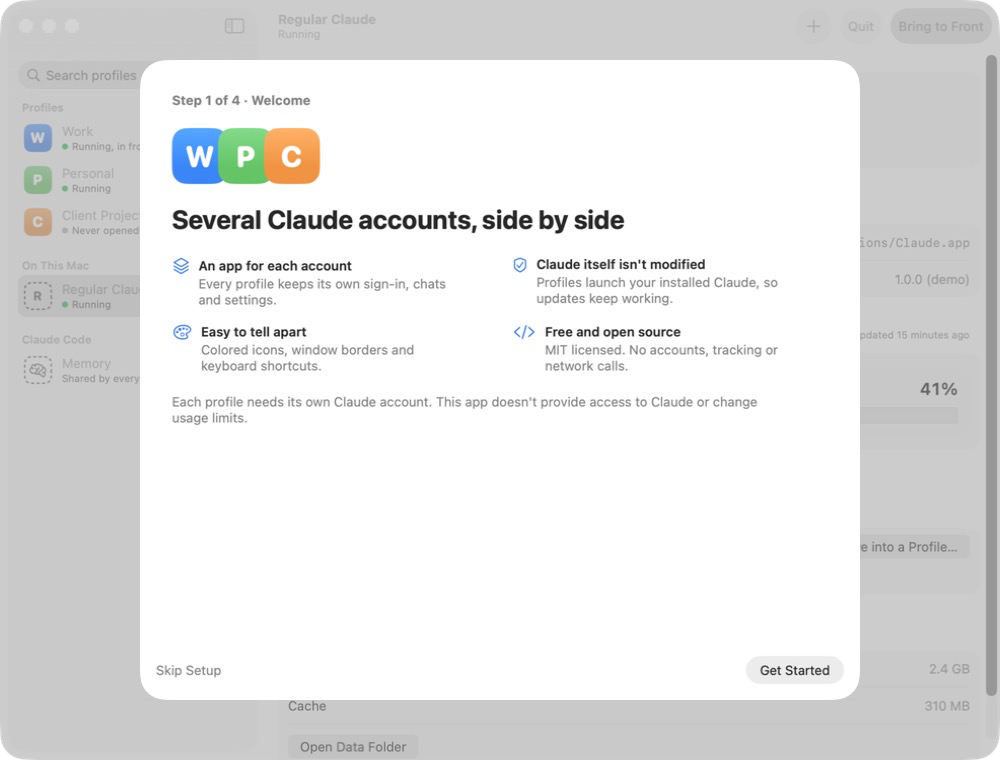
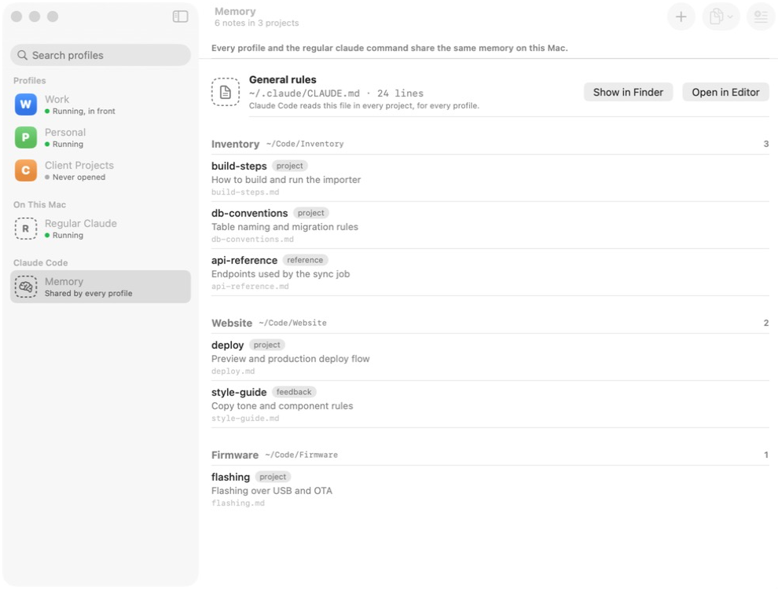

# Claude Multi Account

Run several Claude Desktop accounts side by side on one Mac — work, personal, client — each in its own
window, with its own sign-in, settings, MCP servers and Claude Code sessions.

[](https://github.com/ApolloAutomation/ClaudeMultiAccount/actions/workflows/ci.yml)
[](https://github.com/ApolloAutomation/ClaudeMultiAccount/releases/latest)

[](LICENSE)

Free and open source. No account, no license key, no analytics, no network calls.



> **Not affiliated with Anthropic.** "Claude" is a trademark of Anthropic, PBC. This app launches the
> official Claude Desktop you already have installed; it never modifies it.

## Features

**Profiles**
- One app per profile in your Dock, Launchpad and Spotlight — `Claude (Work)`, `Claude (Personal)`…
- Each gets Claude's icon with a colored letter badge, and an optional colored border around its windows,
  so you always know which account you're typing into.
- Start empty, **move your existing Claude into a profile without signing in again**, or restore a backup.
- A warning when two profiles are signed into the same account.

**Switching**
- A global keyboard shortcut per profile to open it or bring it to the front.
- Add to Dock, Desktop shortcut, and a menu bar panel listing every profile with its status and plan usage.
- Dock menu on each profile: Bring to Front / Quit.

**Plan usage** — 5-hour and weekly usage for every profile at a glance, read from what Claude already
records locally.

**Bring things over from regular Claude**
- Import MCP servers, extensions and developer settings (copies only what's missing).
- Sync Claude Code sessions both ways — the newer copy wins and anything replaced is backed up first.

**Claude Code**
- A per-profile terminal command (`claude-work`) that runs the `claude` CLI with that profile's config.
- A Memory page for your `CLAUDE.md` rules and per-project notes: copy notes between projects or promote
  them to general rules.

**Links** — optional `claude://` routing: one Claude open → it goes there; several → you pick.

**Backups & storage** — data and cache sizes, Clear Cache, Export / Restore a profile as a `.zip`.

**Extras** — launch at login, front profile's letter in the menu bar, pause Spotify while Claude is using
the microphone.

### Screenshots

| Onboarding | Memory page |
|---|---|
|  |  |

<sub>Screenshots use the app's built-in sample data (`--mock`).</sub>

## Requirements

- macOS 26 (Tahoe) or later, Apple silicon or Intel
- [Claude Desktop](https://claude.ai/download) installed in `/Applications`

## Install

1. Download `Claude-Multi-Account-<version>.dmg` from the
   [latest release](https://github.com/ApolloAutomation/ClaudeMultiAccount/releases/latest).
2. Drag **Claude Multi Account** into Applications and open it.

If macOS says the app "can't be opened" (release builds are not notarized unless noted in the release),
either open **System Settings → Privacy & Security** and click **Open Anyway**, or run:

```bash
xattr -dr com.apple.quarantine "/Applications/Claude Multi Account.app"
```

The onboarding walks you through creating your first profile.

### Moving your current Claude into a profile

This moves `~/Library/Application Support/Claude` into the profile in one atomic rename, so the sign-in
keeps working. To keep a copy first, quit Claude and run:

```bash
ditto ~/Library/Application\ Support/Claude ~/Desktop/Claude-backup
```

## How it works

Claude Desktop is an Electron app, and Electron accepts `--user-data-dir`. Each profile is a tiny wrapper
app (`~/Applications/Claude Multi Account/Claude (<Name>).app`) whose only job is to start a **separate
instance of your installed Claude** pointed at that profile's folder:

```
Claude (Work).app ──launches──▶ /Applications/Claude.app --user-data-dir=…/Profiles/<id>
```

- Profile data lives in `~/Library/Application Support/Claude Multi Account/Profiles/<id>`.
- Your regular Claude (`~/Library/Application Support/Claude`) keeps working as before.
- Claude itself is never patched or re-signed, so its own auto-updates keep working; the profile app
  reopens on the right profile after an update.
- Sign-in tokens are never read, copied or exported.

The design and safety rules are in [docs/ARCHITECTURE.md](docs/ARCHITECTURE.md).

## Build from source

Requires Xcode 26 (Swift 6.2+). No third-party dependencies.

```bash
git clone https://github.com/ApolloAutomation/ClaudeMultiAccount.git
```

```bash
cd ClaudeMultiAccount && swift test
```

```bash
scripts/build-app.sh && open "build/Claude Multi Account.app"
```

`build-app.sh` options (environment variables):

| Variable | Default | Effect |
|---|---|---|
| `UNIVERSAL=1` | off | Build arm64 + x86_64 |
| `VERSION` | `1.0` | `CFBundleShortVersionString` |
| `BUILD_NUMBER` | `1` | `CFBundleVersion` |
| `CODESIGN_IDENTITY` | `-` (ad-hoc) | Signing identity; a real identity also enables the hardened runtime |

### Project layout

| Target | What it is |
|---|---|
| `CMACore` | Pure logic: profiles, Claude data formats, sync/import planning, validation |
| `CMASystem` | macOS integration: launching, process scanning, Dock, hotkeys, bundles, backups |
| `ProfileAgent` | The executable inside every profile app |
| `ClaudeMultiAccount` | The SwiftUI manager app and menu bar panel |

## Releases

Pushing a tag like `v1.2.0` runs the [release workflow](.github/workflows/release.yml): it tests, builds a
universal app, packages a `.dmg` and `.zip` with SHA-256 checksums, and publishes a GitHub Release with
generated notes. If Developer ID secrets are configured, the build is also signed and notarized.

```bash
git tag v1.2.0 && git push origin v1.2.0
```

## Contributing

Issues and pull requests are welcome. Please run `swift test` before opening a PR — CI runs the same
tests plus a full app build.

## License

[MIT](LICENSE) © 2026 Apollo Automation
